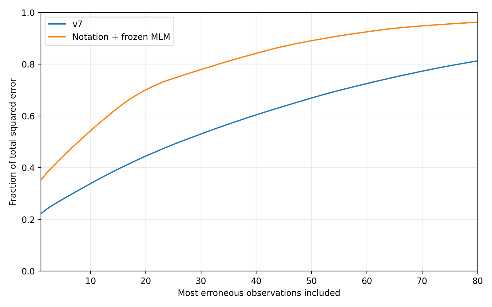

# Аудит SI и итоговый кандидат, 7 ноября 2026

Подготовлен новый `submission.csv`: **597 строк**, колонки `index,SI VACV`. На общих scaffold-фолдах MSE выбранной конфигурации снизилась с **17 964 365.74** у v7 до **11 341 011.02** (−36.87%). Вложенная процедура выбора конфигурации дала **13 320 654.52**, а не 11.34 млн. Новый результат Kaggle **неизвестен**. Лучший подтверждённый Public MSE остаётся **9 421 022.05828** у v7 по скриншоту пользователя.

Все 320 меток уже использовались в истории проекта. Вложенная проверка и новые разбиения уменьшают отдельные виды оптимизма, но не создают независимый набор и не учитывают полностью адаптивный выбор исследовательских гипотез. Выигрыш пока установлен локально.

## 1. Восстановленное состояние и правила

Изучены README, история v2–v7, отчёты о внешних данных, парсер ChEMBL, код и сохранённые прогнозы. Применимых AGENTS.md не обнаружено. Основа аудита — main `adc5d9bc9ca4de1733d3604f48756c3b71ab5dfc`; исходники и артефакты v7 восстановлены из ранее разрешённой ветки PR №1, коммит `368c69feb439542254bffa90e28d058aa5879790`. Файлы main сохранены, включая обновлённый парсер.

Полный [реестр решений](../results/audit_20261107/solution_registry.csv) содержит признаки, преобразование цели, ансамбль, схему оценки, пути к коду/модели/прогнозу и SHA256 CSV. [Реестр Public](../results/audit_20261107/public_score_registry.json) различает исторические записи и сведения пользователя:

| Версия | Public MSE | Основание |
|---|---:|---|
| v1 | 9 992 163.26222 | Историческая запись репозитория |
| v2 | 9 681 096.22474 | Историческая запись репозитория |
| v3 | 9 929 683.57063 | Более поздний отчёт v4 |
| v6 | 9 649 437.79854 | Сообщение пользователя |
| v7 | 9 421 022.05828 | Скриншот пользователя с именем CSV |
| Новый кандидат | неизвестна | Пока не отправлен |

Таким образом, старые фразы README «лучшая v1/v2» и «Public v3/v7 неизвестен» описывали прежние этапы, а не текущее состояние. Файл `results/v7/submission_v7.csv` — альтернативный классификатор; фактически отправленная v7 — `submission_candidate_v7.csv`, фиксированная смесь 50:50. Их нельзя подменять друг другом.

Страницы Kaggle `/data` и `/rules` в сессии недоступны. MSE, разрешение внешних данных и режим **только SMILES** приняты из задания и артефактов; действующие полные правила независимо не подтверждены. Формат проверен по `sample_submit.csv`. Его случайные числовые значения не использованы ни как метки, ни для настройки распределения прогнозов. `strain`, `Culture`, `Title`, концентрации и их пропуски исключены из входов модели. `index` только переносится в выход.

## 2. Что именно предсказывается

[Аудит меток](../results/audit_20261107/target_audit.json) подтвердил:

- 237 строк с обеими концентрациями: все SI согласуются с CC50/IC50; максимальное абсолютное расхождение округления 0.0005.
- 81 строка с отсутствующим IC50: в цели стоит технический код 10000. По пояснению организаторов он означает отсутствие установленной активности в этих условиях, но не является измеренным SI или его числовой границей.
- 2 строки с отсутствующим CC50: в цели стоит 0, физическое отношение не определено.

Основная MSE считается по **всем 320 исходным меткам без замены** в исходной шкале. Вспомогательная задача `y == 10000` обучается только на метках обучающей части соответствующего фолда. Для условной физической регрессии используются измеренные ненулевые отношения из обучения. Проверочные концентрации нужны только для описания ошибок. Инференс работает на CSV, содержащем исключительно SMILES.

## 3. Технические ошибки и проверки

Сохранённые v1/v2/v3/v7 воспроизведены с максимальным абсолютным расхождением от 9×10⁻¹³ до 1.82×10⁻¹¹. Порядок столбцов ядра v1 совпадает с порядком обучающих молекул. Перестановка строк входа v7 сохраняет соответствие прогнозов. Не обнаружено ошибки обратного log1p, подмены MSE на RMSE или смещения строк, объясняющего миллионы единиц ошибки. [Численные проверки](../results/audit_20261107/technical_checks.csv).

Исправлены конкретные проблемы:

1. **Жёсткий сдвиг 917 в v5.** При другом размере train/test внешние метки и ядро адресовались неверно. Синтетический пример: 3 train, 2 test, одна валидная внешняя строка после отбрасывания невалидного SMILES. Ранее конструктор завершался AssertionError; теперь внешний индекс `[5]`, SI `[5]`, ядро 6×6. Смещения вычисляются по фактическим размерам. На текущих 320+597 строках ядро и OOF-прогнозы до/после совпадают точно: MSE **17 964 365.735259127 → 17 964 365.735259127**, Δ=0. Исправлена переносимость, а не заявлено улучшение качества. [Артефакт](../results/audit_20261107/engineering_fixes.json).
2. **Побочная запись при импорте v5/v6.** Создание каталогов перенесено в исполняемую часть. Проверка импорта больше не создаёт результаты.
3. **Численный дрейф эмбеддингов от состава batch.** При batch=32 и переменной длине padding повторный прогноз варианта MLM отличался до 0.00904 SI. Зафиксированы batch=1 и 3 CPU-потока, веса и tokenizer закреплены по revision; признаки пересчитаны. Для одной и той же MLM-конфигурации scaffold MSE изменилась **13 862 335.50 → 13 862 341.83** (+6.33), то есть это исправление воспроизводимости. Текущий переносимый кандидат совпадает с сохранённым CSV до **7.28×10⁻¹²**. [Артефакт](../results/audit_20261107/batch_invariance_fix.json).

В исследовательском коде отдельно устранена ошибка воспроизведения фолдов: одинакового seed недостаточно после изменения кодирования групп. Теперь основная проверка читает фактические назначения `results/v2/validation_splits.csv`, а исторические v1/v2/v3 воспроизводятся на них. Это не исправление ранее отправленного submission.

**50 тестов прошли.** Проверены границы эмпирической ошибки, новые размеры наборов и удаление невалидных внешних строк, изоляция held-out меток при обучении вспомогательных моделей, сохранение модели и совместимость признаков. Дополнительный запуск настоящего CLI только на SMILES и запуск с переставленными строками, заведомо испорченными CC50/IC50/контекстом и фиктивной колонкой цели дали одинаковые прогнозы после сопоставления ID. [Итоговая проверка](../results/audit_20261107/final_validation.json).

## 4. Можно ли получить MSE около нуля

Для одинаковых входов вычислено `sum((y - group_mean_y)**2)/320`. Это нижняя граница **на известных наблюдениях для конкретного представления**, а не на скрытом test.

| Представление | Различных входов | Конфликтных групп | Минимальная эмпирическая MSE |
|---|---:|---:|---:|
| Исходная строка SMILES | 320 | 0 | 0 |
| Полный канонический граф | 312 | 6 | 155 019.40 |
| Стандартизованный parent / tautomer parent | 312 | 6 | 155 019.40 |
| Parent без стереохимии | 311 | 6 | 155 019.40 |
| Morgan, 2048 бит | 306 | 9 | 155 019.63 |
| Feature Morgan, 8192 бит | 295 | 13 | 162 313.68 |

Пример: строки CSV **35 и 219** имеют один полный химический граф, но цели **39.984 и 10000**, при разных условиях эксперимента. Шесть конфликтов уже существуют до удаления солей/таутомерной нормализации: в данном наборе они не возникли от потери заряда, состава или стереохимии. [Все конфликтные наблюдения](../results/audit_20261107/conflicting_inputs.csv) и [таблица представлений](../results/audit_20261107/representation_floors.csv).

Нулевой минимум для сырых строк означает лишь возможность запомнить известные уникальные записи. Он не доказывает предсказуемость новой молекулы. Одинаковая структура может иметь разные измерения при разной клеточной линии, штамме, протоколе и пороге обнаружения; эти условия недоступны модели.

Сохранённое из v7 ограничение прогнозов сверху 10000 само по себе повышает минимум на известных данных до **2 123 347.28** для сырых строк и **2 278 366.67** для полного графа. Это регуляризация с очевидной ценой для большого SI. Диагностическое снятие ограничения не изменило OOF v7: максимальный условный физический прогноз всего **802.99**. Простое удаление cap не восстанавливает отсутствующую информацию о хвосте. **Достижимость MSE≈0 на Kaggle не установлена**; гарантировать её нельзя.

## 5. Где сосредоточена ошибка

Сохранены [сопоставимые OOF всех базовых моделей](../results/audit_20261107/comparable_oof_errors.csv): строка источника, SMILES, метка, прогноз, квадрат ошибки, тип метки, scaffold, максимальное сходство с обучением и ближайшие обучающие структуры с их метками. Отдельно доступны [парные ошибки нового кандидата](../results/audit_20261107/paired_new_model_errors.csv), [крупнейшие ошибки v7](../results/audit_20261107/largest_errors_v7.csv), [нового кандидата](../results/audit_20261107/largest_new_model_errors.csv), диапазоны цели и сходства.

У v7 технические 10000 дают **48.92%** SSE, измеренные отношения — **51.08%**. Одна строка источника **16**, SI=**36066.667**, прогноз≈**331.20**, даёт **22.21%** всей ошибки. Ближайшие доступные молекулы имеют SI 68.13, 134 и 9.596 при максимальном сходстве≈0.527. Нет оснований исправлять её метку или подбирать модель под одно наблюдение: это прежде всего недопредсказанный редкий хвост. Противоречивые экспериментальные условия остаются возможной причиной, не установленной ошибкой записи.

Доли SSE крупнейших 1/5/10/20 ошибок v7: **22.21/27.87/33.86/44.53%**. После улучшения: **35.19/44.40/54.31/70.16%** — ошибка стала сильнее сосредоточена в оставшихся трудных наблюдениях. Абсолютная MSE снизилась; рост долей не означает ухудшения всех этих строк.

Диагностическая подстановка истинного индикатора технического кода в v7 даёт MSE **4.262 млн**, истинного физического компонента — **16.158 млн** при прежнем cap. Это недоступные при прогнозировании oracle-расчёты, использованные только для выбора направления исследования. Они показали больший резерв классификатора кодировки.

Наибольший выигрыш нового кандидата связан со scaffold-группой из 24 строк: сокращение SSE **550.20 млн**, около **26.0%** общего сокращения SSE. Выигрыш не ограничен этой группой: [вклады всех групп](../results/audit_20261107/groups_driving_improvement.csv) и [отдельных наблюдений](../results/audit_20261107/observations_driving_improvement.csv). Brier вероятности кода снизился **0.14148 → 0.07361**, ROC AUC вырос **0.82050 → 0.95157**. Это выбранные OOF-оценки, не независимый тест.



Проверены все найденные submission: ID, схема и порядок; сохранены [распределения](../results/audit_20261107/submission_audit.csv), [корреляции](../results/audit_20261107/submission_correlations.csv), попарный RMSE **между прогнозами**, [крупнейшие расхождения](../results/audit_20261107/submission_disagreements.csv). Последний RMSE не является ошибкой по неизвестной цели. Веса не подбирались по Public leaderboard.

## 6. Гипотезы, выполненные эксперименты и сравнение

[Ранжирование до основных запусков](../results/audit_20261107/hypotheses_ranked_before_trials.json): сначала улучшение вероятности кода, затем калибровка/ансамбль и сравнение сырого/канонического SMILES; физический хвост, расширение fingerprints и повторное добавление известных данных имели меньшую доказательную поддержку. Для каждого направления указаны основания, риск и стоимость.

Заморожены два encoder DeepChem — ChemBERTa-77M-MTR и ChemBERTa-77M-MLM. Проверены исходная строка, канонический SMILES и среднее по каноническому плюс трём детерминированным случайным SMILES. Эмбеддинг: mean по значимым токенам + CLS, 768 значений. Обучались только регуляризованные logistic/KRR головы, scaler и параметры ядра — внутри обучения. Дополнительно проверена cross-fitted калибровка прежних вероятностей. После наблюдения сильного эффекта сырой записи выполнено **одно объявленное расширение**: 9 фиксированных признаков нотации и одна фиксированная смесь 50:50 с MLM; весь вложенный отбор повторён с расширенным конечным пулом. Всего 23 головы, их полные и 50%-смеси с v7, v7 и вариант без cap: 48 конфигураций. Затем поиск остановлен.

| Модель / процедура | Scaffold OOF MSE | Parent OOF MSE |
|---|---:|---:|
| Воспроизведённая v1 | 19 173 935.93 | — |
| Воспроизведённая v2 | 19 041 223.06 | — |
| Воспроизведённая v3 | 18 888 578.92 | — |
| v6 | 18 085 564.68 | — |
| **v7** | **17 964 365.74** | **12 630 406.69** |
| MLM, исходный SMILES | 13 862 341.83 | 7 499 383.81 |
| 9 признаков записи SMILES | 12 187 437.63 | 11 273 891.61 |
| **Выбранная фиксированная смесь** | **11 341 011.02** | **8 200 412.35** |
| **Вложенная процедура выбора из конечного пула** | **13 320 654.52** | **8 200 412.35** |

Scaffold — фактические архивные 5 фолдов; parent — 5 фолдов без пересечения таутомерных структур без стереохимии, seed=42. Внутренние 3-фолдовые scaffold и parent CV выбирают конфигурацию по среднему относительному MSE к v7. Проверочные строки внешнего фолда не участвуют во внутреннем обучении/масштабировании/калибровке и выборе веса. Оценка фиксированного победителя оптимистична относительно выбора; вложенный результат описывает процедуру для зафиксированного пула, но всё равно не полностью независим от истории исследования.

Отрицательные результаты: MLM canonical≈**21.065 млн**, MLM augmented≈**22.145 млн**, MTR raw≈**20.628 млн**, калибровка v7≈**19.392 млн** на основных scaffold-фолдах. Удаление жёсткого source-gate в двух дополнительных диагностических вариантах не улучшило одновременно обе схемы; они не выбраны. [Все конфигурации](../results/audit_20261107/targeted_development.csv), [протокол](../results/audit_20261107/targeted_protocol.json), [вложенные фолды](../results/audit_20261107/targeted_nested_folds.csv).

При замороженном победителе на seed 901/902/903:

| Повторная оценка на тех же данных | v7 | Новый кандидат |
|---|---:|---:|
| Scaffold, pooled MSE | 17 122 928.42 | 10 494 822.58 |
| Parent, pooled MSE | 13 716 098.56 | 8 139 677.48 |

Выигрыш получен во всех трёх повторах каждой схемы. Bootstrap по химическим группам после усреднения ошибок одной строки по повторам: 95% интервал изменения MSE **[−10.053; −3.295] млн** для scaffold, **[−8.153; −3.186] млн** для parent. Это условная оценка устойчивости на наблюдённых данных, не интервал будущего Public MSE.

Дополнительный стресс-тест по 40 компонентам групп контекста (`strain|Culture` только для группировки, с объединением одинаковых parent) дал **23.330 → 14.991 млн**. Это не DOI-disjoint проверка, она не использована для выбора и не разрешает подать контекст в модель.

**Интерпретация сырой записи.** 71 молекула с ароматической Kekulé-нотацией не имеет кода 10000; среди RDKit-канонических строк доля кода≈13.4%, среди прочих≈40.4%. Это сильная связь способа записи с происхождением/кодировкой метки. Исходные строки не содержат имён после SMILES, pipe-аннотаций или буквального кода 10000; найден один хвостовой пробел. Канонизация стирает часть полезного для этого соревнования сигнала. Однако это **не доказательство биологической закономерности**: перенос на новые источники и принудительно канонизированный test может существенно ухудшить модель.

## 7. Внешние данные и фактический состав модели

Vero-38 — точное подмножество all-cells-56; все строки уже присутствуют в проверенной таблице репозитория. Оба файла содержат одни и те же **38 структур, 15 scaffold**. Пересечения: 3 структуры train и 16 test. После удаления совпадений структур train/test остаются **19 наблюдений, 19 структур, 14 scaffold**; после исключения также всех их scaffold — **0 новых scaffold и 0 строк**. Эти файлы не дают независимую валидацию. [Аудит новизны](../results/audit_20261107/external_novelty_audit.json).

Обновлённая выгрузка парсера содержит 6853 endpoint-записи, 2735 технически валидных и 329 предварительных пар: 152 IC50 и 177 EC50. Новые пары не были автоматически превращены в SI для обучения; EC50 не подменяет IC50, границы не считаются точными числами. **Новых числовых SI в исследовании не добавлено.**

Чтобы измерить эффект новой головы отдельно, сохранён физический компонент развёрнутой v7: 237 измеренных организаторских строк при полном обучении и внешний банк **V=56, C=49** с весом 1. V — публикационно проверенные пары, C — унаследованные предварительные пары по структуре/публикации/линии; **49 C нельзя считать публикационно подтверждёнными**. Совпадающие V/C записи дедуплицированы. В каждом OOF-фолде внешние метки молекул и scaffold проверки исключены; допустимое число внешних строк 87/94/104/52/97. Внутренняя калибровка также исключает свои проверочные структуры и scaffold.

Абляция только физического банка с неизменной выбранной головой на тех же scaffold-фолдах:

| Банк физической регрессии | MSE |
|---|---:|
| Унаследованный V+C | 11 341 011.02 |
| Только проверенный V | 11 356 198.90 |
| Только организаторские измеренные SI | 11 338 757.40 |

Это очень малые различия рядом с выигрышем классификатора. Source-presence и точный внешний lookup в этих абляциях сохранены: последняя строка **не означает полное отсутствие внешней информации**. Банк после выбора не перенастраивался по этой диагностике.

Итоговая модель: среднее вероятностей двух logistic-голов — 9 признаков записи (C=1) и raw MLM (C=0.1); старая source-presence поправка по замороженной базе ChEMBL, определяемая только SMILES; прежний условный Tanimoto/torsion KRR с log1p и fold-safe Duan smearing; прежний точный внешний lookup и cap 10000. Source-presence — вспомогательная информация о попадании структуры в зафиксированный открытый источник, а не колонка организаторов; при изменении источника её тоже потребуется переоценить. В локальной проверке нет внешнего lookup по held-out молекулам. На полном обучении lookup сохранён как в отправленной v7; его вклад в неизвестную тестовую MSE отдельно не измерим.

## 8. Файлы, воспроизведение и следующий шаг

- [Готовый submission.csv](../results/audit_20261107/submission.csv) · [ZIP с единственным submission.csv](../results/audit_20261107/submission.zip).
- [Обученная модель](../results/audit_20261107/selected_model.joblib) · [обучение](../src/run_targeted_research.py) · [инференс](../src/predict_research.py).
- [Версии, хеши и состав](../results/audit_20261107/reproducibility_manifest.json) · [все разбиения](../results/audit_20261107/targeted_splits.csv) · [зависимости](../requirements-research.txt).
- [Тесты](../tests/test_audit_research.py) · [лог 50 тестов](../results/audit_20261107/unit_tests.txt).

Проверено на Python 3.12.14 / Linux / CPU. Из корня новой ветки:

```bash
python -m venv work/venv
source work/venv/bin/activate
python -m pip install -r requirements-research.txt
export HF_HOME="$PWD/work/hf_cache"
export HF_HUB_DISABLE_XET=1
OPENBLAS_NUM_THREADS=1 OMP_NUM_THREADS=1 python src/audit_regression.py
OPENBLAS_NUM_THREADS=1 OMP_NUM_THREADS=3 python src/extract_chemberta.py --batch-size 1 --threads 3
OPENBLAS_NUM_THREADS=1 OMP_NUM_THREADS=1 python src/run_targeted_research.py
OPENBLAS_NUM_THREADS=1 OMP_NUM_THREADS=1 python src/postprocess_research.py
OPENBLAS_NUM_THREADS=1 OMP_NUM_THREADS=3 python src/validate_research.py --context-stress
python -m unittest discover -s tests -v
```

Для одного прогноза из опубликованной модели не требуется переобучение:

```bash
OPENBLAS_NUM_THREADS=1 OMP_NUM_THREADS=3 python src/predict_research.py \
  --model results/audit_20261107/selected_model.joblib \
  --input data/raw/test.csv --out work/repeated_submission.csv
```

Веса encoder скачиваются при первом обращении и кэшируются в `work/chemberta_snapshots`; требуется интернет и несколько сотен МБ диска. Checkpoint-ы **не включены** в GitHub, закреплены точные revision [MLM](https://huggingface.co/DeepChem/ChemBERTa-77M-MLM/tree/ed8a5374f2024ec8da53760af91a33fb8f6a15ff) и [MTR](https://huggingface.co/DeepChem/ChemBERTa-77M-MTR/tree/66b895cab8adebea0cb59a8effa66b2020f204ca). Нужно отдельно соблюдать условия распространения исходных весов; доступность хостинга не устанавливает лицензию. Подробные SHA256 исходных данных и весов записаны в manifests. Кэши эмбеддингов, большие веса и промежуточные модели не публикуются. Повторные расчёты на другой версии BLAS/платформе могут иметь небольшие численные отличия.

Следующий наиболее полезный источник — **независимая, сопоставимая по условиям выборка**, включающая неактивные соединения с явным правилом кодировки и редкие высокие измеренные SI, с DOI/assay ID и новыми scaffold. Контекст нужен для проверки источников и разделения, даже если правила не разрешают его в признаки. Для physical SI нужны парные IC50/CC50 одного эксперимента, а не произвольные отношения из разных assays. До такой проверки стоит отправить один готовый кандидат и сохранить v7 как контроль; не настраивать десятки новых вариантов по Public leaderboard.
