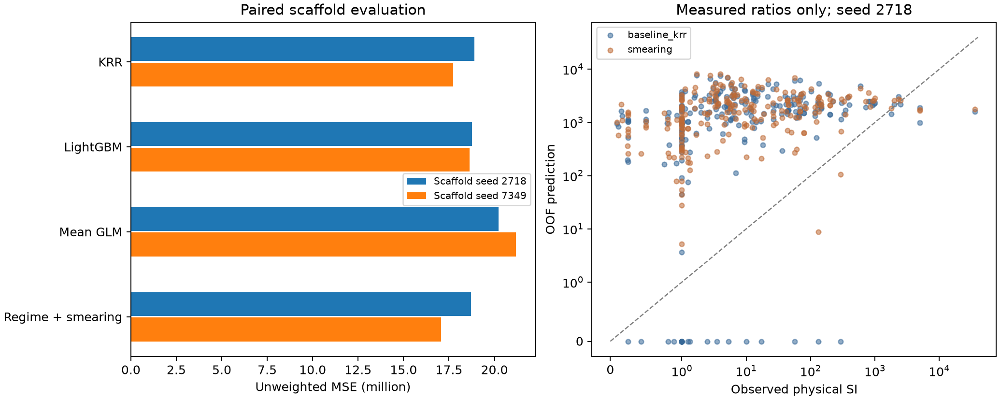

# SI VACV: причины занижения, новые модели и внешние данные

Дата: 07.11.2026. Все новые численные оценки ниже вычислены кодом и сохранены в `results/si_tail_evidence`. Исторические Public-оценки из README не являются новыми результатами этого исследования.

**Устойчивое улучшение физического хвоста с сохранением остального качества не подтверждено.** У новых моделей есть отдельные снижения общей MSE, но они не дают согласованного выигрыша по физическому хвосту, малым/средним SI и неопределённости. Финальный строгий структурный артефакт сохраняет KRR, а новый кандидат и его CSV сохранены отдельно. Историческая v7 с признаком присутствия в ChEMBL также проверена на тех же фолдах; она не заменялась новым более слабым решением.

## 1. Данные и действительные ограничения задачи

Использованы README, история репозитория и скриншот Dataset Description пользователя. Описание предусматривает сбор открытых молекулярных данных и требует SMILES/IC50/CC50/SI/DOI. Оно запрещает организаторские `CC50_uM` и `IC50_uM_VACV` как предикторы. Ранее проверенные Kaggle URL возвращали 404; после предоставления скриншота это не трактуется как запрет внешнего дополнения.

VACV означает вирус вакцинии. Данные других вирусов из тех же публикаций не добавлялись. Работа ограничена опубликованными измерениями, качеством данных и статистическими моделями; лабораторные инструкции не извлекались.

Из 320 организаторских строк **237** имеют обе концентрации и согласованный SI, **81** содержит технический код 10000 при отсутствующем IC50, **2** — технический ноль при отсутствующем CC50. Все 320 меток сохраняются в основной MSE. Концентрации и метаданные используются только в отдельном аудите/отборе внешних данных; fit новых моделей получает структуры и разрешённую цель.

Подлинная крупнейшая метка — **36066.667**, row_index=14, source_row=16; она равна `1082/0.03` при единицах мкМ и контексте Vero. Значение 36666.667 в постановке — опечатка. Исходный DOI и операторы сравнения организаторских концентраций отсутствуют. Сходная статья упоминается в литературе, но конкретная пара структура–измерение не подтверждена. Метка не удаляется и не объявляется ошибкой.

После нормализации 320 различных строк SMILES дают 312 структур. Есть 3 группы с существенными противоречиями, включая одну структуру с SI=39.984 и 10000. Минимальная эмпирическая MSE для детерминированного прогноза по этой нормализованной структуре составляет 155 019.40. Это граница для данных/представления, а не оценка популяционного Bayes risk. Найдены 3 Morgan-паттерна, общие разным каноническим структурам; экстремальная строка в эти коллизии не входит.

## 2. Воспроизведение прежних результатов

На тех же 5 scaffold-фолдах seed=2718:

| model | MSE | max_abs_difference_vs_previous |
| --- | --- | --- |
| reference_krr_raw | 18 897 306.38 | 0.00 |
| control_lgbm_raw | 18 755 172.81 | 0.00 |
| H2_combined_ridge | 20 598 729.91 | 0.00 |

Расхождение OOF-прогнозов с сохранёнными v5-файлами — порядка 1e-12. Переход от прежних baseline к новым методам не смешивается с изменением разбиений.

## 3. Почему хвост не восстанавливается автоматически

В проблемном фолде максимум числовой обучающей цели — 10000, физического SI — 5000. Ближайшие разрешённые соседи экстремальной структуры имеют Tanimoto 0.527 и 0.491, но SI 68.130 и 134. Ни сходство, ни соседние метки не подтверждают величину 36067.

В исторической v6/v7 обнаружена верхняя проекция до 10000. Однако её снятие не изменило ни один OOF-прогноз: до границы они не доходили. Следовательно, это потенциальное ограничение реализации, но не подтверждённая причина текущих прогнозов около 300. Новые модели верхней границы не имеют. Отдельный синтетический пример LightGBM даёт 1.993112 при max(y_train)=1: любые boosting-модели не объявляются универсально ограниченными обучающим максимумом.

Логарифмический прогноз имеет другую проблему: обратное преобразование среднего логарифма не равно условному среднему исходного Y. Исправление этого смещения проверено, но не создаёт отсутствующие сведения о зависимости больших физических SI от структуры.

Разложение новой смеси для известного экстремума особенно показательно: общий прогноз 1766.64, вероятность технического кода 0.168266, вклад `10000*p_code` около 1682.66, физический компонент **100.97**. Оценённый фактор обратного преобразования равен 5.721903. Численное приближение к большому SI в основном связано с кодовым режимом; физический хвост модель не выучила.

## 4. Источники и три направления проверки

Полная [библиография с выводами, допущениями и ограничениями](si_tail_evidence_sources.md) отделяет полные тексты, аннотации и ранее курированные данные.

1. **Пределы реализации:** сравнить исторический capped и uncapped прогноз при одинаковом fit, исключив внешние записи проверочных структур/остовов и внешние test-идентичности. Никакого lookup SI проверочных молекул. Изменение результата оказалось нулевым.
2. **Непосредственная модель условного среднего:** регуляризованный log-link GLM по signed-log RDKit-дескрипторам; Poisson/Tweedie/Gamma, power=1/1.5/2, alpha=1/10/100. По Santos Silva–Tenreyro и документации GLM это модель среднего в исходной шкале, а не log-OLS. Сдвиг Y+1 обратим и поддерживает два числовых нуля. Масштабирование, импутация, масштаб цели и выбор параметров — внутри обучения.
3. **Структурно-зависимое обратное преобразование:** известный технический режим и физический компонент; centered KRR по Morgan+torsion, gate с Morgan/feature-Morgan, внутренние scaffold-OOF остатки. Контроли — без поправки и глобальная Duan-style поправка. Новая поправка — сглаженное условное среднее exp(остатка) с K²-сходствами и prior_count=5/25; alpha физического KRR=3/10. Величина поправки оценивается по обучающим остаткам, произвольный множитель экстремуму не задаётся.

Это не попытка обучить редкий физический tail-gate: одна наблюдаемая метка выше 10000 не позволяет оценить его вероятность и условную величину. GPD/EVT не подгонялась по одному экстремуму. Масса 10000 не интерпретируется как набор физических превышений.

## 5. Основная оценка и выбор

5 внешних scaffold-фолдов, 3 внутренних для выбора кандидатов, для поправки обратного преобразования — отдельный grouped cross-fit. Повторы seed=2718 и заранее выбранный 7349 используют те же 320 молекул и не являются независимыми выборками. 117 generic Bemis–Murcko групп; одинаковые канонические таутомеры объединяются. Сохраняются внешние, внутренние и калибровочные разбиения. Все оценки и выбор параметров — невзвешенная raw MSE. 19 фиксированных конфигураций, без ранней остановки по внешним меткам.

| model | 2718 | 7349 | mean_two_seeds |
| --- | --- | --- | --- |
| smearing_global_control | 18 687 448.82 | 17 076 282.34 | 17 881 865.58 |
| smearing_none_control | 18 732 144.80 | 17 045 019.98 | 17 888 582.39 |
| smearing | 18 707 142.43 | 17 073 443.97 | 17 890 293.20 |
| baseline_krr | 18 897 306.38 | 17 726 003.59 | 18 311 654.98 |
| nested_selector | 19 083 449.05 | 18 276 335.35 | 18 679 892.20 |
| baseline_lgbm | 18 755 172.81 | 18 631 484.56 | 18 693 328.68 |
| mean_glm | 20 221 411.60 | 21 187 971.62 | 20 704 691.61 |

`smearing` и `mean_glm` оценивают процедуру внутреннего выбора семейства, `nested_selector` дополнительно выбирает между семействами. Это оценка конкретных процедур; последующее ранжирование по внешним OOF не превращает победителя в независимо подтверждённую модель.

Сравнение средних по двум повторам, с общей для всех моделей проекцией отрицательных прогнозов в ноль:

| model | all | physical_low | physical_medium | physical_tail | technical_10000 |
| --- | --- | --- | --- | --- | --- |
| baseline_krr_nonnegative | 18 303 252.81 | 5 782 079.63 | 5 260 570.03 | 87 079 465.52 | 41 422 617.94 |
| baseline_lgbm_nonnegative | 18 684 293.69 | 6 706 105.40 | 9 361 252.64 | 89 246 000.67 | 39 154 055.05 |
| mean_glm_nonnegative | 20 704 691.61 | 6 616 761.01 | 6 544 035.53 | 81 951 035.85 | 49 309 795.60 |
| smearing_nonnegative | 17 890 293.20 | 6 343 426.97 | 5 870 712.56 | 86 377 638.95 | 38 344 256.03 |

При неотрицательной цели проекция отрицательных прогнозов в ноль не может увеличить квадрат ошибки. Это фиксированная граница области цели, не обрезание больших прогнозов. Raw-оценки сохранены отдельно. Относительно сильнейшего прежнего структурного baseline KRR новая смесь ухудшает MSE малых SI на **9.71%**, средних — на **11.60%** в среднем по повторам. Поэтому снижение общей MSE само по себе не удовлетворяет поставленному ограничению качества.

Парный bootstrap по scaffold-группам, с усреднением потерь повторов одного объекта до ресэмплинга: разность MSE смеси и KRR = -412 959.61, 95% интервал [-1 520 207.75; 499 259.91]. Интервал включает ноль. Это условная диагностика сохранённых OOF-ошибок без переобучения во bootstrap; история выбора представлений и гипотез не устраняется таким интервалом.

Бюджет изменения ошибки смеси относительно KRR на seed=2718, в единицах вклада в общую MSE (деление на 320):

| stratum | n | MSE_contribution_removed | MSE_contribution_added | net_MSE_contribution_change |
| --- | --- | --- | --- | --- |
| physical_low | 198 | 577 408.87 | 955 996.65 | 378 587.78 |
| physical_medium | 22 | 106 994.15 | 116 305.82 | 9 311.67 |
| physical_tail | 17 | 65 063.67 | 28 106.53 | -36 957.14 |
| technical_10000 | 81 | 1 108 107.06 | 577 040.01 | -531 067.05 |
| technical_zero | 2 | 1 767.86 | 456.10 | -1 311.75 |

Так видно отдельно, сколько ошибки устранено и сколько добавлено в каждой непересекающейся части цели. Полный бюджет обоих повторов сохранён в `final/paired_error_budget.csv`.

## 6. Известный экстремум и независимость вывода

Прогнозы при истинном SI=36066.667 на основном разбиении:

| model | observed | prediction | squared_error |
| --- | --- | --- | --- |
| baseline_krr | 36 066.67 | 1 585.24 | 1 188 968 537.43 |
| baseline_lgbm | 36 066.67 | 2 218.13 | 1 145 723 212.97 |
| mean_glm | 36 066.67 | 2 957.74 | 1 096 201 257.18 |
| smearing | 36 066.67 | 1 766.64 | 1 176 491 801.08 |
| nested_selector | 36 066.67 | 1 585.24 | 1 188 968 537.43 |
| smearing_none_control | 36 066.67 | 1 696.65 | 1 181 298 061.79 |
| smearing_global_control | 36 066.67 | 1 766.64 | 1 176 491 801.08 |

Этот пример уже изучался раньше и не является независимым подтверждением. Его вклад и крупнейшие ошибки остальных строк сохранены в `largest_error_contributions.csv`. Ошибки кодов, физического хвоста и остальных SI разделены. Диагностический хвост — физические значения выше 95-го процентиля обучающей части; технические коды из расчёта порога исключены. Число таких проверочных строк различается между повторами (17 и 12), поэтому определения и n сохраняются рядом с метриками.

MSE и смещение физического хвоста на основном разбиении:

| model | n | MSE | bias |
| --- | --- | --- | --- |
| baseline_krr | 17 | 72 744 227.95 | -1 692.54 |
| baseline_lgbm | 17 | 70 512 595.21 | -2 078.65 |
| mean_glm | 17 | 68 144 988.65 | -784.34 |
| smearing | 17 | 72 034 736.40 | -1 508.86 |
| nested_selector | 17 | 72 861 706.89 | -1 623.87 |
| smearing_none_control | 17 | 72 216 200.91 | -1 595.20 |
| smearing_global_control | 17 | 72 026 243.55 | -1 511.96 |

## 7. Дополнительная проверка экстраполяции

В каждом внешнем обучающем фолде вычислен 90-й процентиль физического SI и удалены целые обучающие scaffold-группы, содержащие значения выше него. Валидационные структуры не меняются. Это диагностическая смена распределения обучения, а не замена основной CV и не основание удалить экстремум из финального обучения. Новая подгонка гиперпараметров выполняется только на оставшемся обучении.

Сохранены отдельные метрики выше фактического физического диапазона обучения, максимумы/квантили, число физических хвостовых строк и наибольший прогноз. Техническая числовая масса 10000 может остаться в обучении, но не называется физическим верхним диапазоном. Результаты этой проверки не использованы при финальном выборе.

## 8. Внешние данные: что действительно добавилось

Прежние 56 курированных строк — 38 структур, включая 38 Vero-строк и 18 повторных A549-контекстов. Они не считаются заново найденными. Проверены совпадения с организаторскими train/test, прежней курированной базой и всеми 2211 каноническими структурами прежней сырой ChEMBL-выгрузки.

Новый DOI `10.3390/v15010029`: 16 строк полной VACV Table 1; 14 точных пар, 2 исключения NA/границ. **13 новых молекул и 1 новый остов** относительно train и прежней выгрузки. Два новых SI выше 10000, максимум 18214.333333. Сохраняются исходные концентрации, единицы, операторы, SD, опубликованный SI, рассчитанное отношение средних, DOI и степень атрибуции структуры. Для этого DOI не выдумываются ChEMBL activity ID.

Доля SI>10000 составляет 2/14 в новой точной таблице против 1/237 среди организаторских измеренных отношений. Источник был найден целевым поиском хвоста; полная таблица снижает отбор отдельных удачных соединений, но не устраняет публикационное смещение и корреляцию аналогов. При знаменателях 0.03±0.01 и 0.04±0.01 мкМ большой SI чувствителен к точности знаменателя. Это не основания заменить точные средние границами, удалить их или объявить ошибками.

После исключения test-идентичностей исследовательский банк содержит 36 строк. На каждом внешнем и внутреннем фолде дополнительно исключаются совпадающие валидационные структуры и остовы. Проверены веса источников 0, 0.1, 1; code-gate не обучается на внешних физических SI. Внешние концентрации и метаданные не являются входными признаками.

| model | n | MSE | RMSE | MAE |
| --- | --- | --- | --- | --- |
| none | 320 | 18 687 448.82 | 4 322.90 | 3 097.97 |
| previous_curated_w0.1 | 320 | 18 691 355.15 | 4 323.35 | 3 097.32 |
| previous_curated_w1 | 320 | 18 717 167.30 | 4 326.33 | 3 095.90 |
| new_publication_w0.1 | 320 | 18 684 923.28 | 4 322.61 | 3 097.22 |
| combined_w0.1 | 320 | 18 688 936.33 | 4 323.07 | 3 096.65 |
| combined_w1 | 320 | 18 704 199.32 | 4 324.84 | 3 095.97 |

Улучшение от новой публикации при весе 0.1 очень мало и не меняет итоговый выбор. Старые или объединённые внешние записи не дают преимущества контрольной конфигурации на основной MSE. Сохранена отдельная ретроспективная проверка всей новой публикации: исключены все её структуры/остовы из организаторского обучения и прежнего внешнего банка. Проверяется только физический компонент; её MSE не является соревновательной оценкой:

| old_external | n | physical_MSE | organizer_train_n | external_train_n |
| --- | --- | --- | --- | --- |
| False | 14 | 32 229 599.37 | 304 | 0 |
| True | 14 | 32 212 626.50 | 304 | 19 |

## 9. Историческая сильная модель v6/v7

Дополнительно прочитана и воспроизведена ветка `codex/v7-regression-20261107-333336`, а не только README текущей main. На тех же разбиениях, без lookup валидационных SI:

| seed | model | MSE | extreme_prediction |
| --- | --- | --- | --- |
| 2718 | legacy_v7_external_capped | 17 963 696.36 | 324.82 |
| 2718 | legacy_v7_external_uncapped | 17 963 696.36 | 324.82 |
| 2718 | legacy_v7_no_external_labels_capped | 17 927 200.46 | 325.32 |
| 2718 | legacy_v7_no_external_labels_uncapped | 17 927 200.46 | 325.32 |
| 7349 | legacy_v7_external_capped | 16 305 470.23 | 329.83 |
| 7349 | legacy_v7_external_uncapped | 16 305 470.23 | 329.83 |
| 7349 | legacy_v7_no_external_labels_capped | 16 270 277.29 | 410.61 |
| 7349 | legacy_v7_no_external_labels_uncapped | 16 270 277.29 | 410.61 |

Эта модель использует признак присутствия структуры в ChEMBL и старый банк уровней V/C; tier C не проходит новую независимую сверку публикационной пары. Вариант `no_external_labels` всё ещё использует source-presence, что прямо отмечено в его протоколе. Эти результаты — более сильные исторические сравнительные точки, но не доказательство физического переноса по одной структуре: часть качества связана с происхождением технической кодировки. Ни один новый метод не объявляется превосходящим эту модель. Она и её прежние submission-файлы не заменялись; в строгом новом протоколе метаданные оставлены для отбора/аудита, а не как source-membership признак.

## 10. Сохранённый итог и ограничения

Строгий структурный контрольный артефакт: **baseline_krr_nonnegative**, средняя MSE двух повторов **18 303 252.81**. В финальном fit сохранены все 320 организаторских строк. Внешние метки испытаны и не включены автоматически при отсутствии подтверждённого преимущества. Новая смесь/условная поправка и её отдельный submission сохранены в `benchmark/` для проверки, без заявления улучшения Kaggle.

`final/submission.csv`: 597 строк, правильные уникальные индексы и порядок sample; диапазон [0.000000, 9425.941718]; верхней границы нет. Перезагрузка модели воспроизводит прогнозы. Ни значения sample-файла, ни test-концентрации, ни test-метки не используются для калибровки. Public/Private score нового файла неизвестен; автоматической отправки в Kaggle не было.

47 тестов и 8 существующих subtests прошли. Независимо пересчитаны 196 строк метрик; пересечений внешних, внутренних и калибровочных групп нет. CSV обоих артефактов воспроизведены из сохранённых моделей, хеши записаны в `verification.json`. Финальный структурный CSV отличается от прежнего `submission_candidate_v3.csv` не более чем на 1.73e-11; это воспроизведение baseline, не новый заявленный выигрыш.

Не хватает подтверждённого происхождения организаторского экстремума, сопоставимых опубликованных высоких физических SI на нескольких переносимых структурных группах и ясного разделения кодировки/физических измерений. Дополнительные независимые публикационные данные нужны для проверки этой экстраполяции; произвольный коэффициент для одной известной молекулы не заменяет такую информацию.



На правой диаграмме применяется только фиксированная проекция отрицательных прогнозов в ноль; верхняя часть диапазона не обрезается.

## Воспроизведение

Из корня репозитория, Python 3.12; выходные каталоги должны быть новыми:

```bash
python -m venv .venv
source .venv/bin/activate
python -m pip install torch==2.15.0 --index-url https://download.pytorch.org/whl/cpu
python -m pip install -r requirements.txt -r requirements-si-tail-evidence.txt
HF_HOME=work/hf_cache HF_HUB_DISABLE_XET=1 python src/audit_si_tail_evidence.py --out results/evidence_reproduced/audit
OPENBLAS_NUM_THREADS=2 OMP_NUM_THREADS=2 python src/benchmark_si_tail_evidence.py --out results/evidence_reproduced/benchmark
OPENBLAS_NUM_THREADS=2 OMP_NUM_THREADS=2 python src/benchmark_si_tail_evidence.py --out results/evidence_reproduced/extrapolation --diagnostic --no-final
python src/curate_si_tail_evidence.py --out results/evidence_reproduced/external_audit
OPENBLAS_NUM_THREADS=2 OMP_NUM_THREADS=2 python src/ablate_external_si_tail.py --bank results/evidence_reproduced/external_audit/research_training_bank.csv --out results/evidence_reproduced/external_ablation
OPENBLAS_NUM_THREADS=2 OMP_NUM_THREADS=2 python src/analyze_si_tail_evidence.py --benchmark results/evidence_reproduced/benchmark --out results/evidence_reproduced/final
python src/predict_si_tail_evidence.py --model results/evidence_reproduced/final/model.joblib --input data/raw/test.csv --out work/repeated_submission.csv
python -m pytest tests -q
python src/validate_si_tail_evidence.py --results results/evidence_reproduced
python src/report_si_tail_evidence.py --results results/evidence_reproduced --report work/reproduced_evidence_report.md
```

Для исторической проверки:

```bash
git fetch origin codex/v7-regression-20261107-333336
git worktree add --detach work/reference_v7 FETCH_HEAD
python src/audit_legacy_si_tail.py --legacy-root work/reference_v7 --out results/evidence_reproduced/legacy_audit
python src/audit_legacy_si_tail.py --legacy-root work/reference_v7 --seed 7349 --out results/evidence_reproduced/legacy_audit_repeat
```

Фактический commit и хеши исходников исторической модели записаны в её protocol.json. Основной новый benchmark не зависит от этой ветки. Скрипт первоначальной ChEMBL-выгрузки, её DOI/activity ID и журнал запросов уже находятся в `src/download_external.py` и `data/external/`; новый сборщик добавляет отдельную полную публикационную таблицу.
